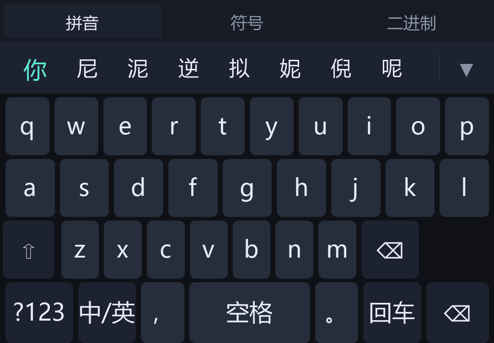
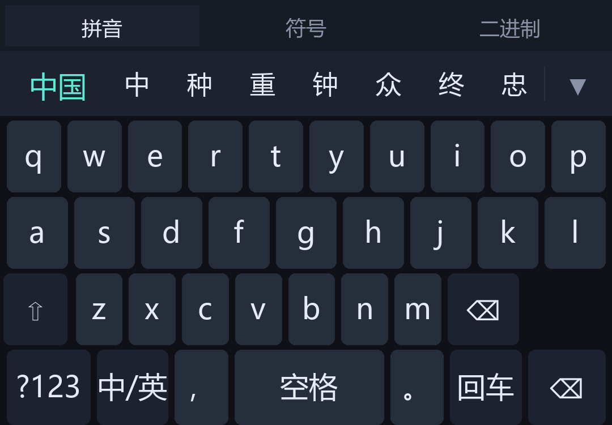
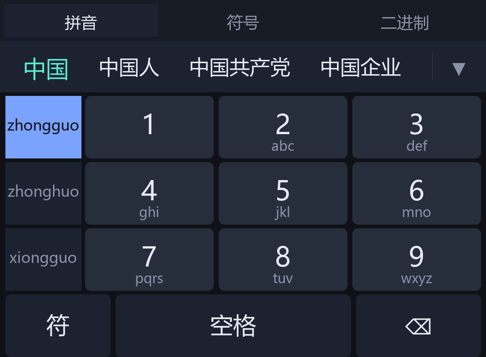
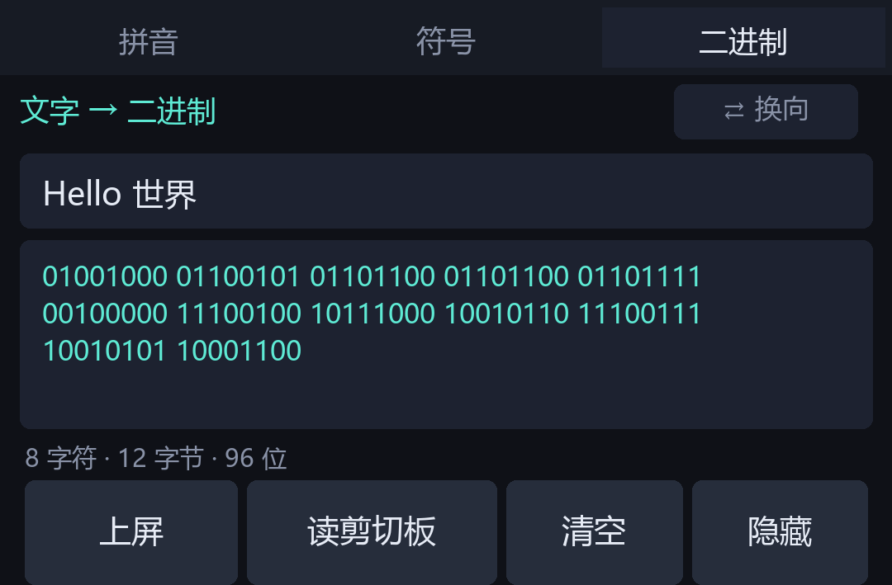
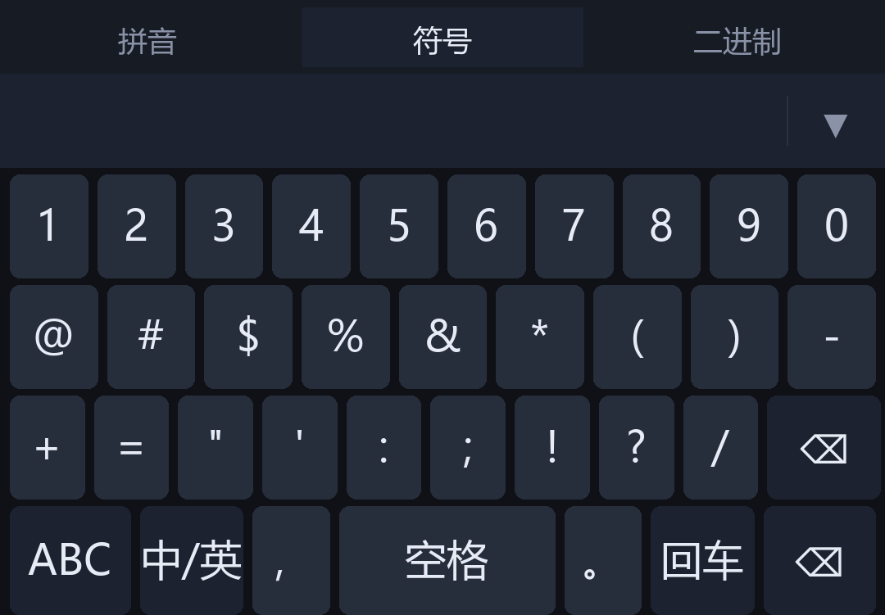

# BinIME · 一个能输入二进制的安卓输入法

> 在手机输入框里直接把文字转成二进制，也能把二进制译回文字。
> 不需要 root，不修改任何系统应用，装完勾选就能用。

> [!NOTE]
> **这个项目全部由 AI 制作。**
> 从第一行代码到这份文档，包括词库构建、测试用例、界面设计、构建脚本，全部由 AI 编写。
> 人类只负责提需求、在真机上试用、反馈哪里不好用。详见[关于作者](#关于作者)。


---

## 这东西解决什么问题

有些场景需要手打二进制：调试协议、给硬件发指令、玩 CTF、跟人斗图对暗号。
手机上要么开个网页转换器来回复制粘贴，要么写个脚本。都很难受。

BinIME 把这件事做进了输入法本身——**在任何输入框里，直接输入二进制**。

顺带一提，它同时是个**完整的拼音输入法**：54.8 万条离线词库、整句解码、九键、
云端补词。二进制是特色功能，不是玩具。

---

## 界面

| 全键盘 | 候选栏 | 九键 + 拼音选择列 |
|---|---|---|
|  |  |  |

| 整句解码 | 二进制面板 | 符号页 |
|---|---|---|
|  |  |  |

---

## 功能

### 二进制（核心特色）

顶部点「二进制」切到专门的面板，两个方向都能用：

| 方向 | 用法 |
|---|---|
| **文字 → 二进制** | 输入文字，下方实时出二进制，点上屏直接打进当前输入框 |
| **二进制 → 文字** | 粘贴 0/1 串，下方实时出译文 |

支持的格式比想象中宽容：

| 输入 | 结果 |
|---|---|
| `01001000 01101001` | Hi |
| `0100100001101001` | Hi |
| `0b01001000_0b01101001` | Hi |
| `0100-1000 0110-1001` | Hi |
| `01001000,01101001` | Hi |

空格、连写、`0b` 前缀、下划线、短横线、逗号都认。
编码用 UTF-8，解码时依次尝试 `UTF-8 → GBK → Big5 → Latin-1`，中文和 emoji 不会乱码。

还有一个**可选悬浮窗**：桌面上的 `01 / BIN` 小圆球，点开就是双向转换面板，
不用切到输入法就能用。

### 拼音输入

内置 **54.8 万条词库**（8586 个单字 + 53.98 万词组），**完全离线**，不联网也能打。

- `zhongguo` → **中国**，`nihao` → **你好**，`beijing` → **北京**
- 打 `zhongg` 也能前缀补全出「中国」
- 音节自动切分：`woaini` → `wo`+`ai`+`ni`；`xian` 不会被错拆成 `xi`+`an`
- 首候选青色高亮，空格直接上屏

查询实测 **0.16 ms/次**。

### 整句解码

打一长串拼音，候选栏最前面直接给整句：

```
woxiangchifan  →  我想吃饭
64426          →  你好          （九键）
94664486       →  中国 / 中国人 / 中国共产党
```

原理是**多重音节切分 + 动态规划**。一个拼音串可能拆成几十种音节组合
（`xian` = `xian` 或 `xi`+`an`），每种组合查词后取总分最高的一句。

打分用一元语言模型：`score = Σ log(词权重 / 全库总权重)`。
后半截 `-log(总权重)` 是每个词都要付一次的固定代价，所以「切得越碎付得越多」——
**「倾向整词」是模型自己算出来的，不是手调的阈值**。

### 九键

设置里切成九键，3×3 数字网格，**左边还有一列拼音选择条**：

```
  nihao  │  1        2 abc    3 def
  nigao  │  4 ghi    5 jkl    6 mno
  nigan  │  7 pqrs   8 tuv    9 wxyz
  ───────┴────────────────────────────
     符          空格             ⌫
```

数字串到拼音是一对多：`94664486` 可能是 `zhongguo` 也可能是 `xionghuo`，
光靠候选栏猜经常出不来想要的。左边列出最可能的几种拼音，**点一下锁定**（蓝底），
候选立刻只按它出；再点一次取消。按新数字键会自动清掉锁定。

- **长按 `1`** 直接输逗号，长按其他键 = 空格
- **长按 `⌫` 连续删除**：超过 320ms 开始连删，节拍 `120→90→65→45→32ms` 逐档加快，松手立刻停

### 其他

- **收起键盘**：候选栏右侧 `▼`，点一下收下去，不用滑屏幕
- **底部留白**：设置里 0–60dp 可调，专门对付 ColorOS 把「切换输入法」胶囊
  画在键盘上面、系统 insets 又不让位的问题
- **云端补词**（可选）：本地没词时联网补几条，可关，失败静默，不收集任何内容

---

## 技术上的几个选择

### 不用 Gradle，手工构建

```
aapt2 compile/link → javac → d8 → zipalign → apksigner
```

整个 `build.sh` 90 行。原因很实际：`maven.google.com` 在国内直连超时，
而手工构建的产物和 Gradle 完全等价。副作用是构建快到 3 秒，依赖也一目了然。

### 拼音引擎是自己写的

没引第三方库。词库从 [rime-ice](https://github.com/iDvel/rime-ice) 的四个
`.dict.yaml` 编译成自定义二进制格式：

```
magic "BPY2" + 词条数 + 音节数
  + keyOff[]  + hzOff[]  + weight[]  + sylOff[]
  + keyPool   + hzPool   + sylPool
```

全部大端 int32 偏移 + UTF-8 字符串池，按 `(key, -weight)` 排序后二分查找。
89 万条原始数据压到 **8.0 MB**（gzip 后），打进 APK。

### 467 项测试，8 组

| 组 | 断言数 | 内容 |
|---|---|---|
| 编解码核心 | 37 | 双向转换、各种分隔符、编码回退、边界 |
| 拼音引擎 | 46 | 词库加载、前缀/精确查询、音节表、性能 |
| 音节切分 | 30 | 切分正确性、`xian` 不误拆、非法输入 |
| 九键 | 23 | 数字映射、拼音反推、候选排序 |
| 整句解码 | 117 | 多切分打分、beam 搜索、边界、性能 |
| 云端补词 | 98 | 响应解析、过滤、并发、过期丢弃（假 Transport，不联网） |
| 端到端冒烟 | 25 | **真词库**跑实际取候选路径 |
| 静态审查 | 91 | 读源码检查约束（权限、资源引用、设置项两端一致等） |

最后两组是重点。**端到端冒烟**用真词库跑，专门防「算法对但词库接错」——
这类 bug 单元测试全绿，但用户一眼就能看出错。**静态审查**不跑 App，
直接 grep 源码检查那些编译器和测试都发现不了的约束。

```bash
bash run_tests.sh     # 任一失败退出码非 0
```

---

## 快速开始

### 装 APK

从 [Releases](../../releases) 下载 `BinIME.apk`，传到手机上安装
（需允许"安装未知来源应用"）。

然后：

```
① 启用输入法 → 系统设置里勾选「二进制输入法」
② 切换输入法 → 选「二进制输入法」
```

### 自己构建

需要：JDK 17+、Android SDK（`platforms/android-36` + `build-tools/36.0.0`）

```bash
export JAVA_HOME="/path/to/jdk"
bash build.sh        # 产物在 build/BinIME.apk
bash run_tests.sh    # 跑回归
```

不用联网拉依赖，不用 Gradle。

### 改词库

```bash
bash tools/fetch_dictsrc.sh     # 从 rime-ice 下载四个 .dict.yaml
python tools/build_dict.py      # 编译成 app/assets/pinyin.dict.gz
```

---

## 已知限制

- **只测过 ColorOS 16 / Android 16**（minSdk 34），其他 ROM 没验证
- **没有用户词频学习**：整句解码用通用词频，长句里人名/小众词可能选错
- **剪切板不能后台自动监听**：Android 10 起只有获得焦点的应用能读剪切板，
  这是系统限制不是功能缺陷。输入法里点「读剪切板」不受影响
- **流体云没做**：ColorOS 16 的流体云对应 Android 16 Live Updates API，
  关键方法 `setRequestPromotedOngoing()` 不在公开 SDK 里；而且通知的
  `RemoteViews` 不支持 `EditText`，天生做不了输入

---

## 源码结构

```
binfloater-android/
├── build.sh                    手工构建（aapt2 + javac + d8 + apksigner）
├── run_tests.sh                一键回归（8 组 467 项）
├── app/
│   ├── assets/pinyin.dict.gz   拼音词库（8.0 MB，548393 条 + 414 音节）
│   └── src/com/binf/ime/
│       ├── BinCore.java        二进制编解码核心
│       ├── PinyinEngine.java   词库读取 + 二分查询
│       ├── PinyinComposer.java 组字状态机 + 音节切分
│       ├── T9Engine.java       九键：数字串 → 拼音 / 音节反推
│       ├── SentenceDecoder.java 整句解码（多切分 + 动态规划）
│       ├── CloudSuggest.java   云端补词（可关）
│       ├── BinImeService.java  输入法服务（全键盘 + 九键 + 二进制面板）
│       ├── MainActivity.java   主界面（引导 + 设置）
│       └── FloatingService.java 悬浮窗
├── tools/                      词典编译、预览图生成、10 个测试类
├── signing/                    签名密钥说明（密钥本体不进仓库）
└── dist/                       预览图
```

---

## 许可

MIT，见 [LICENSE](LICENSE)。

---

## 关于作者

**这个项目全部由 AI 制作。**

代码、词库构建脚本、467 项测试、界面、构建流程、这几份文档，全部是 AI 写的。
人类的角色是：提需求、在 ColorOS 16 真机上试用、指出哪里不对（比如"九键打不出想要的"、
"退格不能长按连删"），然后由 AI 定位原因并改。整个过程中没有手写过一行业务代码。

AI 工具：[DeepSeek Harness](https://github.com/deepseek-ai)（DeepSeek-V4 系列模型）。
需求提出与真机验收：[BlestHeart](https://github.com/BlestHeart)。

之所以明说，是因为这确实是个能用的东西——但它不是人写的，这一点不应该被含糊过去。

---

## 相关

- **[DEVELOPMENT.md](DEVELOPMENT.md)** —— 开发笔记：构建细节、测试体系、设计取舍、踩过的坑
- **[BinFloater](https://github.com/BlestHeart/BinFloater)** —— Windows 桌面版：剪切板里的 0/1 串自动翻译成文字，也能把文字转成二进制，常驻悬浮窗（独立仓库）
- 词库来源：[iDvel/rime-ice](https://github.com/iDvel/rime-ice)
