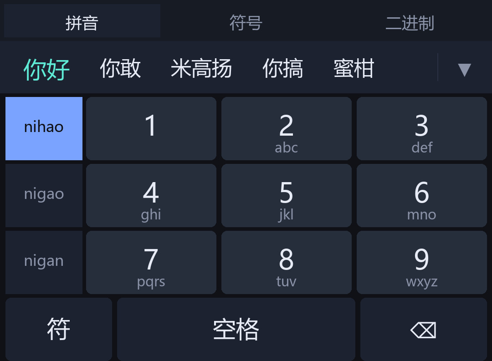

# 二进制输入法 · BinIME（ColorOS 16 / Android 16）

在手机输入框里直接把文字转成二进制，也能把二进制译回文字。**不需要 root，不修改任何系统应用。**



## 安装

1. 把 `dist/BinIME.apk` 传到手机上，点击安装（需允许"安装未知来源应用"）
2. 打开 App，按页面提示操作：

```
① 启用输入法 → 系统设置里勾选「二进制输入法」
② 切换输入法 → 选「二进制输入法」
```

3. 在任意输入框里点一下，键盘弹出后点顶部的 **「二进制面板」**

## 功能

### 拼音输入（主力模式）

内置 **54.8 万条拼音词库**（8586 个单字 + 53.98 万词组），离线可用，不联网。

- 直接打拼音，候选栏实时出字：`ni` → 你 / 尼 / 泥 / 逆…
- 整词优先：`zhongguo` → **中国**，`nihao` → **你好**，`beijing` → **北京**
- 前缀补全：打 `zhongg` 也能出「中国」
- 音节自动切分：`woaini` 自动拆成 `wo`+`ai`+`ni`；`xian` 不会被错误拆成 `xi`+`an`
- 首候选用青色高亮，点空格直接上屏首选
- 候选栏末尾 `×` 清空误输

词库编译自 Rime 的 `pinyin-simp` / `8105` / `base` / `ext` 四个词典，用 `tools/build_dict.py`
压成 **8.0 MB** 二进制（gzip 后）打包进 APK。查询实测 **0.16 ms/次**。

### 整句解码

打一长串拼音，候选栏最前面会给**整句**结果，不只是一个词：

```
woxiangchifan  → 我想吃饭     （全键盘，4 个字母以上触发）
64426          → 你好          （九键，所有可行音节组合都试）
94664486       → 中国 / 中国人 / 中国共产党
```

做法是**多重音节切分 + 动态规划取最优**：一个拼音串可能拆成几十种音节组合
（`xian` = `xian` 或 `xi`+`an`），每种组合再查词，取总分最高的一句。
这样 `xian` 既能出「先」也能出「西安」，看哪个更常用。

打分用的是**一元语言模型**：`score = Σ log(词权重 / 全库总权重)`。
后半截 `- log(总权重)` 是每个词都要付一次的固定代价，所以「切得越碎付得越多」，
**「倾向整词」是模型自己算出来的，不是手调的阈值**。

> 这里踩过一个坑值得记：最早的写法是加法制
> `score += log(w) + 词奖励 + 字奖励×字数`，结果越长越碎的句子分越高，
> `nihao` 被解成「你哈哦」、`woxiangchifan` 被解成「我洗昂吃翻」。
> 加法式没法表达「多一个词是有代价的」，换成概率式的减法才对。
> 这类错误只有拿**真词库**跑端到端才能发现（`tools/SmokeTest.java` 就是为此加的）。

九键还有个额外坑：数字串展开成拼音时有**几十种切分顺序**，
DFS 默认按字母序产出，`94664486` 的前 8 种全是 `xi+o+mi+guo` 这种碎切，
`zhongguo` 根本不在里面。所以展开时要按**音节权重概率**排序
（`T9Engine.pinyinListByScore`），再把各拼音串的整句结果按分数统一合并——
音节权重高的不一定是词权重高的，`zhonghuo` 音节分高但「中国」词分更高。

### 九键输入

设置里把「键盘布局」切成**九键**，键盘变成 3×3 数字网格，**左边还有一列拼音选择条**：

```
  nihao  │  1        2 abc    3 def
  nigao  │  4 ghi    5 jkl    6 mno
  nigan  │  7 pqrs   8 tuv    9 wxyz
  ───────┴────────────────────────────
     符          空格             ⌫
```

- 按数字，程序把数字串**反推**成所有可能的拼音组合再查词
- 例：`64426` → `ni hao` / `ni ha o` / `migao`… → 候选「你好」「你敢」「米高扬」
- **左侧拼音列**：数字串到拼音是一对多，`94664486` 可能是 `zhongguo` 也可能是
  `xionghuo`，光靠候选栏猜经常出不来想要的词。左边列出当前数字串最可能的几种拼音，
  **点一下锁定**（蓝底高亮），候选立刻只按它出；**再点一次取消锁定**回到自动猜。
  按新的数字键会自动清掉锁定，因为数字串变了原来的拼音就对不上了。
- **长按 `1`** 直接输入逗号；长按其他键 = 空格（上屏首选）
- **长按 `⌫` 连续删除**：按住超过 320ms 开始连删，节拍从 120ms 逐档加快到 32ms
  （`120 → 90 → 65 → 45 → 32`），松手立刻停。点一下仍然是删一个。
- 底部 `符` 键切到符号页，符号页是通用的，全键盘/九键共用

### 收起键盘

候选栏**右侧有个 `▼`**，点一下就把键盘收下去（等价于系统返回键），
不用再滑屏幕。

- 放在候选栏而不是底排：这一行每页都看得见（符号页也在），
  而且是整块键盘里离拇指最远的地方，误触率最低
- 符号页/二进制页时候选列表用 `INVISIBLE` 隐藏而不是 `GONE`：
  候选区带 `weight=1f`，`GONE` 掉会让收起键滑到最左边，位置每页都在变
- 字形用 `▼`（U+25BC）而不是 `⌄`（U+2304）：后者在不少安卓系统字体里缺字形，
  会显示成方块

### 键盘布局

- QWERTY 全键盘 + `⇧`（单击大写一次，再点锁定）+ `⌫`
- 九键 / 全键盘在设置里随时切换，重新弹出键盘生效
- `?123` 切换数字/符号页
- `中/英` 快速在中英与符号页之间切换
- `，` `。` `回车` `空格` —— 空格在拼音未上屏时先上屏首选词
- 顶部「二进制」标签一键切到二进制面板

### 避开 ColorOS 的「切换输入法」按钮

ColorOS 16 会在输入法窗口**之上**画一个「切换输入法」胶囊按钮和手势条，
系统不会把它算进 `WindowInsets` 给输入法让位，所以默认设置下键盘最后一行会被压住。

修法是两个：

1. 读 `WindowInsets` 拿到真实系统栏高度，底部至少留 **系统栏高度 + 8dp**
2. 设置里再加一个「**底部留白**」滑块（0–60dp，默认 26dp），觉得压手就调大

### 云端补词（可选）

本地词库没有的词，联网从公开输入法接口补几条候选。设置里可关。

- 只在本地候选不足时才请求，且只补到候选栏末尾，不抢本地结果
- 输入变化时自动丢弃过期请求的结果（防串词）
- 网络失败静默忽略，不影响本地输入
- 需要 `INTERNET` 权限（已声明），不收集、不上传任何内容

### 二进制面板

顶部有个 `⇄ 切换方向`，两个方向都能用：

| 方向 | 用法 |
|---|---|
| **文字 → 二进制** | 输入文字，下方**实时**出二进制，点「上屏」直接输入到当前输入框 |
| **二进制 → 文字** | 粘贴 0/1 串，下方实时出译文，点「上屏」 |

其他按钮：

- **紧凑**：去掉空格，输出 `0100100001101001` 连写形式
- **读剪切板**：读剪切板内容，**自动判断方向**（是二进制就译成文字，是文字就转成二进制）并上屏
- **清空** / **⌫** / **隐藏**

### 支持的二进制格式

| 你输入的 | 结果 |
|---|---|
| `01001000 01101001` | Hi |
| `0100100001101001` | Hi |
| `0b01001000_0b01101001` | Hi |
| `0100-1000 0110-1001` | Hi |
| `01001000,01101001` | Hi |

编码：UTF-8。解码依次尝试 `UTF-8 → GBK → Big5 → Latin-1`，中文和 emoji 不会乱码。

### 可选悬浮窗

设置里打开「启用悬浮窗」（需授权"显示在其他应用上层"）：

- 桌面出现一个 `01 / BIN` 小悬浮球，可拖动
- 点一下展开面板，同样是双向转换
- 再点关闭

## 为什么剪切板不是"全自动监听"

**这是 Android 系统限制，不是功能缺陷。**

从 Android 10（API 29）开始，系统规定只有**当前获得焦点的应用**才能读取剪切板，后台应用读到的永远是空内容。

所以安卓版的做法是：

- **输入法读剪切板**：不受此限制（输入法还在前台服务范围内），点「读剪切板」立即生效
- **悬浮窗读剪切板**：点「读剪切板」时才读取（属于用户手势触发），不做后台轮询

对比一下：

| 平台 | 剪切板自动监听 |
|---|---|
| Windows 版 | ✅ 后台常驻监听 |
| 安卓版 | ⚠️ 点一下读取（受系统限制） |

## 为什么不是"解包微信/OPPO 输入法改一改"

你提过用 REA 反编译现成输入法。技术上能做，但**改完装不上**，这是硬墙：

1. **签名校验**：反编译 → 改代码 → 重新打包，签名必然变。Android 不允许签名不同的 APK 覆盖安装，
   只能卸载原版。但系统输入法（OPPO/微信输入法装在 `/system/priv-app`）**卸载不掉**，需要 root + 解锁 BL。
2. **ColorOS 16 的 BL 解锁**：OPPO 已收紧解锁政策，且解锁会清数据、丢保修、部分机型直接不给解。
3. **微信输入法**是闭源商业软件，改包分发有法律风险。

而自己写一个输入法**不需要这些**：普通 APK，装完在设置里勾选就能用，不动系统分区。

所以走了自研路线，代价是要自己搭拼音引擎——现在已经搭好了（54.8 万条词库 + 整句解码，见上）。

## 关于流体云

**暂时没做。** 原因是查证后发现：

1. ColorOS 16 的流体云对应 Google 的 **Android 16 Live Updates API**
2. 但 `setRequestPromotedOngoing()` 这个关键方法**不在 Android 36 公开 SDK 里**，是隐藏 API
3. 通知的 `RemoteViews` **不支持 `EditText`**，所以流体云天生不能做输入

结论：流体云最多能显示"最新译文"（只读展示），且需要额外处理隐藏 API。**可以后续加**，但优先级低于输入法本体。

## 已知限制

- **需要真机验证**：我这边没有连接 OPPO 手机，所以以下内容需要你装上后确认：
  - 键盘按键尺寸在你的屏幕上是否合适
  - 「底部留白」滑块调到多少刚好不压手
  - 中文标点是否符合习惯
  - ColorOS 是否对输入法有额外限制
- **拼音能力边界**：有词库 + 整句解码 + 可选云补词，但**没有用户词频学习**。
  整句解码用的是通用词频，长句里人名/小众词可能选错；日常输入够用，
  重度长文输入还是原生输入法更顺。
- **词库为控体积做过裁剪**：优先砍掉了 `ext` 词典里 base 中没有出现的孤儿词
  （那些词权重全是常数，没有真实词频），最终 54.8 万条 / 8.0 MB。
- **minSdk 34**：只支持 Android 14 及以上。你和你朋友都是 ColorOS 16（Android 16），没问题

## 源码结构

```
binfloater-android/
├── build.sh                    手工构建脚本（aapt2 + javac + d8 + apksigner）
├── run_tests.sh                一键回归（8 组、451 项断言）
├── app/
│   ├── AndroidManifest.xml
│   ├── assets/
│   │   └── pinyin.dict.gz      拼音词典（8.0 MB，548393 条 + 414 音节）
│   ├── res/                    图标、颜色、字符串、输入法配置
│   └── src/com/binf/ime/
│       ├── BinCore.java        编解码核心（与 Windows 版逻辑一致）
│       ├── PinyinEngine.java   词库读取（v2 格式）+ 前缀/精确二分查询
│       ├── PinyinComposer.java 组字状态机 + 音节切分
│       ├── T9Engine.java       九键：数字串 → 拼音候选 / 音节反推 / 展示
│       ├── SentenceDecoder.java 整句解码（多重切分 + 动态规划）
│       ├── CloudSuggest.java   云端补词（可关，失败静默）
│       ├── BinImeService.java  输入法服务（全键盘 + 九键 + 符号页 + 二进制面板）
│       ├── MainActivity.java   主界面（引导 + 设置）
│       └── FloatingService.java 可选悬浮窗
├── tools/
│   ├── build_dict.py           Rime 词典 → 二进制 v2（自动裁剪到 8 MB）
│   ├── render_preview.py       键盘布局预览图生成
│   ├── CoreTest.java           编解码单元测试（37 项）
│   ├── PinyinTest.java         词库引擎测试（46 项）
│   ├── SegmentTest.java        音节切分测试（30 项）
│   ├── T9Test.java             九键测试（23 项）
│   ├── DecodeTest.java         整句解码测试（117 项）
│   ├── CloudTest.java          云补词测试（98 项，注入假 Transport 不联网）
│   ├── SmokeTest.java          真词库端到端冒烟（25 项，防算法对但词库接错）
│   ├── StaticAudit.java        无设备静态审查（91 项）
│   ├── DictProbe.java          诊断：直接读词典看 key/权重（非回归）
│   ├── T9Probe.java            诊断：打印九键各切分的整句分数（非回归）
│   ├── QueryProbe.java         诊断：对比前缀查询与全扫 top-N，查截断（非回归）
│   ├── DupProbe.java           诊断：同 key 下的重复词条（非回归）
│   ├── T9CapProbe.java         诊断：切分枚举被 cap 截断的对比（非回归）
│   ├── T9ScaleProbe.java       诊断：切分枚举的规模与耗时（非回归）
│   └── T9OrderProbe.java       诊断：DFS 序 vs 概率序（非回归）
└── dist/
    ├── BinIME.apk
    └── preview_*.png           各页面预览图
```

## 重新构建

不需要 Gradle，不需要联网拉依赖：

```bash
export JAVA_HOME="/c/Program Files/Zulu/zulu-21"
bash build.sh
```

产物在 `build/BinIME.apk`。

签名密钥在 `build/binf.keystore`（密码 `binf123456`）。
**分发时请自己重新生成密钥**，否则别人能签出同签名包替换你的应用。

## 测试

```bash
export JAVA_HOME="/c/Program Files/Zulu/zulu-21"
bash run_tests.sh          # 一键跑完，任一失败退出码非 0
```

覆盖 8 组，**共 467 项断言**：

| 组 | 断言数 | 内容 |
|---|---|---|
| 编解码核心 | 37 | 双向转换、各种分隔符、UTF-8/GBK 回退、边界 |
| 拼音引擎 v2 | 46 | 词库加载、前缀/精确查询（含短前缀不截断）、音节表、性能 |
| 音节切分 | 30 | `nihao`→`ni,hao`、`xian` 不误拆、非法输入 |
| 九键 T9 | 23 | 数字映射、拼音反推、候选排序、展示切分 |
| 整句解码 | 117 | 多切分打分、beam 搜索、边界、性能 |
| 云端补词 | 98 | 响应解析、过滤、并发、过期丢弃（假 Transport，不联网） |
| 端到端冒烟 | 25 | **真词库**跑实际取候选路径：整句、九键、展示切分 |
| 静态审查 | 91 | 读源码检查约束（无硬编码、权限、资源引用、设置项两端一致等） |

注意两点（都是踩过的坑，已写进脚本注释）：

- 测试必须在**项目根目录**跑，`StaticAudit` 读的是相对路径
- 判定通过要同时看**退出码**和**断言数**，否则编译失败时会假绿

## 下一步可以做

- [ ] 流体云展示最新译文（需要处理隐藏 API）
- [ ] 用户词频自学习（选了哪些词记住并提前）
- [ ] 剪贴板历史
- [ ] 自定义配色/键盘高度
- [ ] 词库分拆按需加载（再压体积）

## 这次更新做了什么（v1.1）

上一版只有 6.5 万条词库、全键盘、没有整句能力。这版补齐了四件事：

1. **词库 6.5 万 → 54.8 万条**（8586 单字 + 53.98 万词组），来自 rime-ice。
   原始 89 万条压出来 12.4 MB 太大，按「砍掉 ext 里 base 没有的孤儿词」降到 8.0 MB。
2. **整句解码**：长拼音串直接出整句，不用一个字一个字选。
3. **九键布局**：设置里可切，3×3 数字键 + 数字反推拼音。
4. **云端补词**：本地不够时联网补几条，可在设置里关掉。

另外修了一个和系统打架的问题：ColorOS 16 会把「切换输入法」胶囊按钮画在输入法窗口之上，
系统 insets 不会给你让位，所以设置里加了「底部留白」滑块（0–60dp，默认 26dp），
觉得压手就调大。

### 开发过程中踩到的真 bug（都记在代码注释里了）

前三个是做功能时撞上的：

- **词典头多写了一个 int**：Python 用 `pack(">iiii", ...)` 写了 4 个，Java 只读 3 个，
  后面全部错位，现象是「所有查询返回空」。格式一旦定下来就别加字段。
- **整句打分用了加法制**：每个词白送 `log(w)+1.10`，切得越碎分越高，
  `nihao` 解成「你哈哦」。换成 `Σ log(w/total)` 的概率式减法才对。
- **九键展开按字母序**：`94664486` 前 8 种切分全是 `xi+o+mi+guo`，
  `zhongguo` 排不进去。改成按音节权重排序 + 跨拼音串按词分合并。

后四个是交付前逐文件复查才挖出来的，共同点是**测试全绿但用户一眼能看出错**：

- **前缀查询截断了**：`query()` 有 `maxScan = max(limit*8, 512)` 的扫描上限，
  而词条按 `(key, -weight)` 排。短前缀横跨几千个 key，扫前 512 条只够到字典序靠前的那批：
  `y` 出来的是「呀、雅虎、牙齿」，「一、有、也」全没了；`zh` 出来「债券、债务」，「制度、这、中」全没了。
  改成「二分定区间 + 区间内只留 top-k 的线性扫描」，扫描过程不构造字符串所以 4.7 万条也就 1ms。
- **九键切分枚举被 cap 挤掉**：`segmentations` 的 DFS 是字母序，`MAX_COMBOS=192` 的配额
  先被短音节组合占满，`zhong/zhuang` 这些 5~6 位长音节排到很后面。8 位以内不受影响，
  13 位以上才开始暴露。改成「先做可达性 DP，再按音节数从少到多枚举」，顺带把切不动的串从 35ms 降到 11us。
- **底部留白被自己抹掉**：`reloadPrefs()` 调 `applyBottomPad(0)`，把系统手势条的高度覆盖成 0，
  于是每次弹键盘最后一排键就被压住。改成只在系统真给了 insets 时才更新，其余沿用上次的值。
- **同字多音显示两遍**：「这」同时挂在 `zhe` 和 `zhei` 下，前缀查询把两条都捞出来。
  加按文本去重（并多取一倍候选，避免去重后不够数）。

这些都不是编译器能发现的。前三个靠 `tools/SmokeTest.java` 拿真词库跑端到端暴露；
后四个是靠对着 `query()` 和 `segmentations()` 写探针、拿 4.7 万条的短前缀和 24 位长串去压才现形的。
所以回归脚本现在是 8 组 467 项，其中端到端那组必须有。

## 这次更新做了什么（v1.2）

1. **收起键盘按钮**：候选栏右侧加 `▼`，点一下收键盘，不用滑屏幕。
2. **长按 `⌫` 连删**：按住超过 320ms 开始连删，节拍 120→90→65→45→32ms 逐档加快，松手立刻停。
   用 `OnTouchListener` 而不是 `OnLongClickListener` —— 后者只在长按触发一次，
   拿不到松手时机，做不了「按住持续删、松手立刻停」。
3. **九键拼音选择列**：左侧竖排 3 个候选拼音，点一下锁定，再点取消。
   九键一对多，猜错时让用户自己指一下比继续猜有用。

### v1.2 踩到的坑

- **`⌄` 渲染成方块**：U+2304 在不少安卓系统字体里缺字形。改 `▼`（U+25BC）。
  这个项目用 `⌖` 踩过一次同样的坑，所以静态审查里加了一条断言专门卡这个。
- **候选区 `GONE` 会把收起键挤走**：候选区带 `weight=1f`，`GONE` 掉之后收起键滑到最左边，
  位置每页都在变。改 `INVISIBLE` 保留占位。
- **松手会多删一个**：`ACTION_DOWN` 返回 false 让点击事件照常派发（点一下删一个），
  但连删启动后松手还会再派发一次 `onClick`。用 `repeatDeleteStarted` 标记，
  连删过的松手吞掉 up 事件。
- **`OnLongClickListener` 做不了连删**：它只在长按触发一次，松手时机拿不到，
  必须用 `setOnTouchListener` 自己管 `ACTION_DOWN`/`ACTION_UP`。
- **锁定拼音要跟着数字串复位**：按新数字键时 `t9PickedPinyin` 必须清空，
  否则会拿上一次的拼音去查新的数字串。

---

## 版本管理

仓库就在项目目录本身（`G:\DeepSeek Harness\binfloater-android\.git`），已经建好并提交了首个快照。

### 常用命令

```bash
git status                      # 看现在改了什么
git add -A && git commit -m "说明"   # 拍一个快照
git log --oneline               # 看所有快照
git show <版本号>               # 看某个快照改了什么
git checkout <版本号> -- 文件    # 把某个文件退回某个版本
git diff                        # 看还没提交的改动
```

### 什么东西进了仓库

| 进 | 不进 |
|---|---|
| `app/` 全部源码、资源、**词库** | `build/`（81 MB 中间产物 + 下载的词典源，可重新生成） |
| `tools/` 全部脚本和测试 | `dist/*.apk`（每次构建都整个变，git 存二进制是整份存的） |
| `dist/*.png` 预览图 | `.class`、`__pycache__` |
| `signing/binf.keystore` **签名密钥** | |
| `README.md`、`build.sh`、`run_tests.sh` | |

仓库总共 51 个文件、8.6 MB（词库占 8.0 MB），`.git` 目录 8.6 MB。

### 两个特意处理过的地方

**1. 签名密钥从 `build/` 挪到了 `signing/`**

`build.sh` 原来把密钥生成在 `build/binf.keystore`。`build/` 被 `.gitignore` 排掉了，
密钥跟着丢的话，下次构建签名就变，手机上没法覆盖安装（只能先卸载，设置全丢）。
现在密钥在 `signing/binf.keystore`，跟着仓库走，见 [signing/README.md](signing/README.md)。

**2. 词典源文件用脚本重新拉**

`build/dictsrc/` 里那 45 MB 的 rime-ice 原始词典不进仓库。需要重建词库时：

```bash
bash tools/fetch_dictsrc.sh     # 从 iDvel/rime-ice 下载四个 .dict.yaml
python tools/build_dict.py      # 编译成 app/assets/pinyin.dict.gz
```

但**编译好的 `app/assets/pinyin.dict.gz` 是提交了的**，所以 clone 下来直接 `bash build.sh` 就能出包，
只有想改词库时才需要跑上面两步。

### 行尾

`.gitattributes` 里统一成 LF（`* text=auto eol=lf`）。这个项目在 Windows 上用 bash 构建，
`.sh` 文件要是被转成 CRLF，bash 会报 `\r: command not found`。`.bat` 除外，保持 CRLF。
